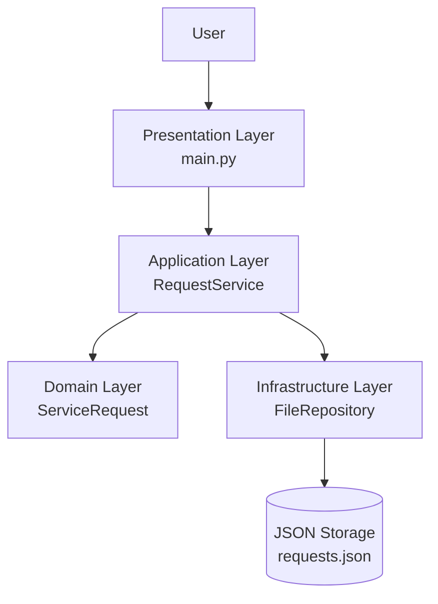
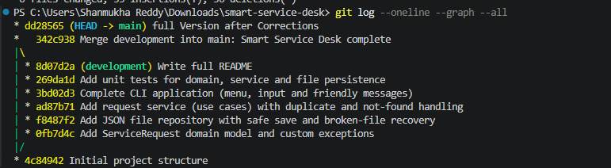

# Smart Service Desk

<p align="center">
  <strong>A Python-Based IT Service Request Management System</strong>
  <br>
  A simple, reliable and structured solution for managing employee IT support requests.
</p>

<p align="center">
  
  
  
  
  
</p>

---

## Table of Contents

1. [Project Overview](#-project-overview)
2. [Project Objectives](#-project-objectives)
3. [Features](#-features)
4. [Technologies Used](#️-technologies-used)
5. [Project Structure](#-project-structure)
6. [System Architecture](#️-system-architecture)
7. [Installation and Execution](#️-installation-and-execution)
8. [Application Demonstration](#-application-demonstration)
9. [Testing](#-testing)
10. [Concepts and Design Principles](#-concepts-and-design-principles)
11. [Git Workflow and Commit History](#-git-workflow-and-commit-history)
12. [Git History Screenshot](#-git-history-screenshot)

---

## Project Overview

**Smart Service Desk** is a command-line IT support request management application developed using Python.

In organizations, employees frequently encounter technical problems such as:

- Laptop startup failures
- Wi-Fi connectivity issues
- Password reset requests
- VPN connection problems

Managing these requests manually can be inefficient and difficult to track.

Smart Service Desk provides a simple solution by allowing support staff to create, view, search, and resolve service requests through an interactive command-line interface.

All requests are stored in a JSON file, ensuring that information remains available even after the application is closed and restarted.

## Project Objectives

- Simplify IT service request management.
- Apply Object-Oriented Programming principles.
- Implement custom exception handling.
- Maintain persistent data using JSON.
- Organize the application using a layered architecture.
- Apply SOLID principles and basic Domain-Driven Design.
- Practice Git branching, commits, merging, and version control.

---

## Features

### Core Features

| Feature | Description |
|:---|:---|
| Create Service Request | Create a request with ID, employee name, issue, and priority. |
| View All Requests | Display all available service requests. |
| Search Request | Retrieve a specific request using its unique ID. |
| Resolve Request | Change request status from `OPEN` to `RESOLVED`. |
| Data Persistence | Automatically save and reload requests using JSON storage. |
| Exit | Close the application safely. |

### Additional Features

The following enhancements were implemented beyond the basic assignment requirements.

| Enhancement | Description |
|:---|:---|
| Automatic Request ID | Suggests the next available request ID. |
| Flexible Input | Accepts different letter cases and removes unnecessary spaces. |
| Input Validation | Prevents empty IDs, employee names, and issue descriptions. |
| Timestamps | Records request creation and resolution times. |
| Request Summary | Displays total, open, and resolved request counts. |
| Safe File Saving | Uses a temporary file before replacing the actual JSON file. |
| Corrupted File Recovery | Preserves damaged JSON data using a `.broken` backup file. |
| Reliable File Paths | Locates the data directory relative to `main.py`. |
| Graceful Interruption | Handles Ctrl+C with a friendly exit message. |
| Unit Testing | Includes 15 automated tests. |

---

## Technologies Used

| Technology | Purpose |
|:---|:---|
| Python | Application development |
| JSON | Data storage and persistence |
| OOP | Modeling service requests |
| Unittest | Automated testing |
| Git | Version control |
| GitHub | Source code hosting |
| Visual Studio Code | Development environment |

**External dependencies:** None. The application uses Python's built-in libraries.

---

## Project Structure

```text
smart-service-desk/
│
├── domain/
│   ├── __init__.py
│   ├── service_request.py
│   └── exceptions.py
│
├── application/
│   ├── __init__.py
│   └── request_service.py
│
├── infrastructure/
│   ├── __init__.py
│   └── file_repository.py
│
├── data/
│   └── requests.json
│
├── tests/
│   ├── __init__.py
│   └── test_service_desk.py
│
├── docs/
│   └── git-commit-history.png
│
├── main.py
├── README.md
└── .gitignore
```

### Folder Responsibilities

| Component | Responsibility |
|:---|:---|
| `domain/` | Contains business entities, rules, and custom exceptions. |
| `application/` | Implements application use cases and operations. |
| `infrastructure/` | Handles JSON file reading and writing. |
| `data/` | Stores service request information. |
| `tests/` | Contains automated unit tests. |
| `docs/` | Contains project documentation and screenshots. |
| `main.py` | Handles user interaction and the command-line menu. |

---

## System Architecture

The application follows a layered architecture that separates business logic, application operations, data storage, and user interaction.

### Architecture Diagram



### Application Workflow

1. The user interacts with the menu in `main.py`.
2. The application layer processes the requested operation.
3. The domain layer validates business rules.
4. The infrastructure layer handles JSON persistence.
5. The application displays the result to the user.

Each component has a clearly defined responsibility. The domain layer does not directly access files or handle user interaction.

---

## Installation and Execution

### Prerequisites

- Python 3.8 or newer
- Git
- Visual Studio Code (recommended)

### Step 1: Clone the Repository

```bash
git clone https://github.com/Anreddy-fractal-ai/smart-service-desk.git
```

### Step 2: Navigate to the Project

```bash
cd smart-service-desk
```

### Step 3: Run the Application

```bash
python main.py
```

On some systems, use:

```bash
python3 main.py
```

**No additional packages are required.**

---

## Application Demonstration

### Main Menu

```text
========================================
       SMART SERVICE DESK SYSTEM
========================================

1. Create Service Request
2. View All Requests
3. Search Request
4. Resolve Request
5. Exit

Enter your choice:
```

### Creating a Service Request

```text
Enter your choice: 1

Enter Request ID: SR101
Enter Employee Name: shannu
Enter Issue: Laptop is not starting
Enter Priority (LOW / MEDIUM / HIGH): HIGH

Service Request created successfully.
```

### Viewing Service Requests

| Request ID | Employee | Issue | Priority | Status |
|:---|:---|:---|:---|:---|
| SR101 | shannu | Laptop is not starting | HIGH | OPEN |
| SR102 | abhi | Wi-Fi keeps disconnecting | MEDIUM | OPEN |
| SR103 | jay | Need password reset | LOW | OPEN |

### Resolving a Service Request

```text
Enter your choice: 4

Enter Request ID: SR101

Service Request SR101 marked as RESOLVED.
```

The updated status is saved automatically and remains available after restarting the application.

### Mandatory Application Demonstration

The following sequence demonstrates the main application functionality:

1. Create service request `SR101`.
2. Attempt to create `SR101` again to demonstrate duplicate ID validation.
3. View all service requests.
4. Search for `SR101`.
5. Resolve `SR101`.
6. Attempt to resolve it again to demonstrate exception handling.
7. Exit and restart the application.
8. Search for `SR101` again and verify that its status remains `RESOLVED`.

---

## Testing

The project includes **15 automated unit tests** covering the domain model, application service, and file persistence.

### Execute the Tests

```bash
python -m unittest discover -s tests -t . -v
```

### Testing Coverage

- Creation of service requests.
- Initial request status validation.
- Duplicate request ID handling.
- Invalid priority handling.
- Empty input validation.
- Searching existing and missing requests.
- Resolving service requests.
- Preventing duplicate resolution.
- JSON data persistence.
- Safe file handling and recovery.

The tests use temporary files, ensuring that the actual application data is not modified during testing.

---

## Concepts and Design Principles

### Object-Oriented Programming (OOP)

The `ServiceRequest` class represents an individual IT support ticket.

The implementation uses:

- Classes and objects
- Constructors
- Attributes and methods
- Encapsulation

### 2. Exception Handling

Custom exceptions provide meaningful error handling for expected application problems.

| Exception | Purpose |
|:---|:---|
| `DuplicateRequestError` | Raised when a request ID already exists. |
| `RequestNotFoundError` | Raised when a request cannot be found. |
| `InvalidPriorityError` | Raised when an unsupported priority is entered. |
| `AlreadyResolvedError` | Raised when an already resolved request is resolved again. |
| `InvalidInputError` | Raised for invalid or empty user input. |

All custom exceptions inherit from `ServiceDeskError`.

### 3. SOLID Principles

The project focuses particularly on:

**Single Responsibility Principle (SRP)**

Each component performs a specific responsibility.

**Dependency Inversion Principle (DIP)**

The application service depends on repository operations rather than directly depending on a specific storage implementation.

### 4. Domain-Driven Design (DDD)

The application separates business logic from technical implementation details.

- **Domain:** Business entities and rules.
- **Application:** Use cases and operations.
- **Infrastructure:** Data storage.
- **Presentation:** User interaction.

---

## Git Workflow and Commit History

Git was used to organize development through two branches.

| Branch | Purpose |
|:---|:---|
| `main` | Stable and final project version. |
| `development` | Feature development and implementation. |

### Development Commit History

The project was developed through meaningful commits, with each commit representing a specific implementation stage.

| Commit ID | Commit Description |
|:---|:---|
| `4c84942` | Initial project structure |
| `0fb7d4c` | Add ServiceRequest domain model and custom exceptions |
| `f8487f2` | Add JSON file repository with safe save and broken-file recovery |
| `ad87b71` | Add request service with duplicate and not-found handling |
| `3b0d2d3` | Complete CLI application with menu, input and friendly messages |
| `269da1d` | Add unit tests for domain, service and file persistence |
| `8d07d2a` | Write full README |
| `342c938` | Merge development into main: Smart Service Desk complete |
| `d028565` | Full Version after Corrections |

### Git Commands Used

```bash
# Display branches
git branch

# Display commit history
git log --oneline --graph --all

# Switch to main
git checkout main

# Merge development into main
git merge --no-ff development

# Push main branch
git push -u origin main

# Push development branch
git push -u origin development
```

The non-fast-forward merge preserves a visible merge commit, making the development and integration history easy to trace.

---

## 📸 Git History Screenshot

The following screenshot shows the actual Git commit history of the project, including the development branch, merge commit, and final version.

<p align="center">
  
</p>

---

<p align="center">
  <strong>Smart Service Desk</strong>
  <br>
  Developed using Python, Object-Oriented Programming, and Git.
  <br><br>
  Thank you for visiting this repository!
</p>
